<!-- generated by scripts/readme/build.mjs. do not edit by hand. -->

<picture>
<source media="(max-width: 500px) and (prefers-color-scheme: dark)" srcset="assets/readme/boot-narrow-dark.svg">
<source media="(max-width: 500px)" srcset="assets/readme/boot-narrow-light.svg">
<source media="(prefers-color-scheme: dark)" srcset="assets/readme/boot-dark.svg">

</picture>

A repository starter for **Claude Code and Codex**. Harness Firmware gives both agents versioned instructions, durable project memory, reusable skills, and workflows for testing and independent review.

Keep project decisions and pitfalls with the code. Carry useful lessons into the next session. Review changes before carrying them into another repository.

[Install the skills or start a repository](#quickstart) · [Visit harnessfirmware.com](https://harnessfirmware.com)

## quickstart

Use the **skills-only plugin** for an existing Claude Code repository. Use the **full template** for a new repository or Codex support.

### existing repository · Claude Code plugin

Run these commands inside Claude Code:

```text
/plugin marketplace add ryanportfolio/Harness-Firmware
/plugin install claude-starter@claude-starter
```

Then try `/claude-starter:recall` or `/claude-starter:brainstorming plan the next feature`. Plugin skills use the `claude-starter` namespace.

### new repository · full template

Create a repository with the kernel, hooks, committed memory, skills, and synchronization tools:

- GitHub: select **Use this template**, clone the new repository, then run Claude Code's `/init-project` command or ask Codex to use the `init-project` skill.
- From a cloned Harness Firmware checkout on macOS or Linux: `bash bootstrap/new-claude-project.sh --name my-app --dest ~/code`
- From a cloned checkout on Windows: double-click `bootstrap/New-ClaudeProject.cmd`.

In the created repository, run `node .claude/scripts/doctor.mjs`. Success means the doctor reports no failures. Then ask Claude Code or Codex to use `recall` before the first unfamiliar change.

[Open the complete setup guide](GUIDE.md#full-template) · [View validation runs](https://github.com/ryanportfolio/Harness-Firmware/actions/workflows/validate-template.yml)

## what the firmware adds

| Need | Workflow built into the repository |
| --- | --- |
| Remember the project | `recall` loads relevant committed facts, decisions, and pitfalls before unfamiliar work |
| Finish sustained work | `long-horizon` records progress and evidence across bounded rounds, with fresh audit context |
| Challenge a result | Independent and cross-vendor review skills check work through available agents or authenticated CLIs |
| Verify a claim | `fable-mode` separates current-state, change, and causal claims and returns a verdict; `perf-loop` measures optimization against a baseline |
| Maintain skills | `addskill` handles creating, importing, updating, and installing skills with the resources each runtime needs |
| Improve the workflow | `refine` captures observed friction; `sync-starter` carries selected generic fixes between repositories |

These are agent instructions and supporting tools. Structural checks validate the package; actual execution still needs the appropriate model, tools, credentials, and evidence.

## the repository feedback loop

<picture>
<source media="(max-width: 500px) and (prefers-color-scheme: dark)" srcset="assets/readme/feedback-narrow-dark.svg">
<source media="(max-width: 500px)" srcset="assets/readme/feedback-narrow-light.svg">
<source media="(prefers-color-scheme: dark)" srcset="assets/readme/feedback-dark.svg">

</picture>

The everyday loop is **recall → work → verify → refine → reviewed repository change → next task**. Project facts load before unfamiliar work. Verification captures evidence. `refine` turns observed friction into a small, reviewable change that strengthens the repository before the next task begins.

The dotted branch is separate: after human review, `sync-starter` can move a generic improvement into the template so future repositories begin with it. Keeping the lesson local remains the default.

## two runtimes, explicit ownership

<picture>
<source media="(max-width: 500px) and (prefers-color-scheme: dark)" srcset="assets/readme/runtime-narrow-dark.svg">
<source media="(max-width: 500px)" srcset="assets/readme/runtime-narrow-light.svg">
<source media="(prefers-color-scheme: dark)" srcset="assets/readme/runtime-dark.svg">

</picture>

**51 Claude Code skills · 47 Codex skills · 47 native Codex workflows**

- **Claude Code:** reads `CLAUDE.md`, `.claude/skills/`, and hooks for canonical playbooks and Claude-specific startup behavior.
- **Codex:** reads `AGENTS.md` and `.agents/skills/` for standalone Codex workflows with explicit capability and safety boundaries; every Claude skill has a maintained native Codex version or is disabled for Codex. [Skill ownership and personal copies](docs/codex-skills.md) explains how they are maintained.

Both runtimes read the committed project topics under `.claude/reference/`. Shared workflows live under `.claude/skills/`; standalone Codex workflows live under `.agents/skills/`.

## 51 workflows, loaded when called

**8 core · 17 discipline · 26 specialist**

Only names and routing descriptions sit in the repository's generated skill index. Full workflow bodies stay on demand. The diagram's byte figures are a repository source-file estimate, not total runtime context; [the guide documents the measurement](GUIDE.md#measure-the-always-loaded-layer).

<details>
<summary><strong>Click to open the generated skill memory map</strong></summary>

<picture>
<source media="(max-width: 500px) and (prefers-color-scheme: dark)" srcset="assets/readme/skills-narrow-dark.svg">
<source media="(max-width: 500px)" srcset="assets/readme/skills-narrow-light.svg">
<source media="(prefers-color-scheme: dark)" srcset="assets/readme/skills-dark.svg">

</picture>

</details>

<details>
<summary><strong>Click to browse all 51 skills</strong></summary>

<!-- skill-list:start -->
### core workflows · 8

- [`init-project`](.claude/skills/init-project/SKILL.md) · Configure a starter project on setup request: detected project facts, only necessary user questions.
- [`recall`](.claude/skills/recall/SKILL.md) · Before unfamiliar project-area work; retrieve project decisions or pitfalls; save authorized durable fact; quirk just cost retry, backed-out change, or user correction → pitfalls.
- [`addskill`](.claude/skills/addskill/SKILL.md) · Create, import, update, or install repo or personal skills: runtime ownership, resources, discovery checks.
- [`sync-starter`](.claude/skills/sync-starter/SKILL.md) · Pull template improvements into a spawned repo, compare starter drift, or push a generic improvement back to the starter.
- [`optimize-context`](.claude/skills/optimize-context/SKILL.md) · Cut per-turn context or token load: trim kernels, skills, connectors; push generic context optimization to starter.
- [`refine`](.claude/skills/refine/SKILL.md) · Explicit workflow-improvement review; user preferences → rules or skill; recurring task friction justifying a narrow skill or reference change; unattended weekly review (/refine weekly).
- [`adopt-repo`](.claude/skills/adopt-repo/SKILL.md) · Mirror external repo privately under user's account + overlay firmware: clone, strip template-only files, privacy-sweep, init-project. Use: /adopt-repo <url>, 'pull this repo into our firmware'.
- [`apply-firmware`](.claude/skills/apply-firmware/SKILL.md) · /apply-firmware, or bring current folder (plain folder, existing repo, old or partial firmware copy) up to full Harness Firmware in place. Mirror external repo → adopt-repo.

### quality disciplines · 17

- [`brainstorming`](.claude/skills/brainstorming/SKILL.md) · Brainstorm or design product, interface, workflow, architecture, or behavior change with unresolved goals or material tradeoffs. Skip routine or fully specified work.
- [`deep-plan`](.claude/skills/deep-plan/SKILL.md) · /deep-plan: interview a loose idea in short decision rounds; stop for explicit go before anything is built.
- [`writing-plans`](.claude/skills/writing-plans/SKILL.md) · Clear task needing a multi-step implementation plan, dependency ordering, or durable handoff. Skip routine changes doable directly.
- [`impartial-review`](.claude/skills/impartial-review/SKILL.md) · Review, audit, or stress-test recent code changes with fresh independent agents. Needs exposed multi-agent tools or authed Codex CLI.
- [`perf-loop`](.claude/skills/perf-loop/SKILL.md) · Measured optimization rounds with independent review: FPS, loading, latency, throughput, resources; no named target → triage every dimension first. Use: /perf-loop, broad perf requests. Skip isolated fixes.
- [`security-loop`](.claude/skills/security-loop/SKILL.md) · Whole-repo security audit or pen-test in independently verified runs → fix owner's picks → rerun until nothing new. Use: /security-loop, 'security-audit / pen-test this codebase'. One diff or question → security-review.
- [`long-horizon`](.claude/skills/long-horizon/SKILL.md) · Work too big for one context window: long multi-step tasks, progress lost to compaction or failed retries, work spanning hours or sessions, /long-horizon, or 'run in verified rounds'.
- [`long-horizon-workflows`](.claude/skills/long-horizon-workflows/SKILL.md) · Long-horizon rounds via Workflow tool: 1 script per batch, fresh baseline, candidate executors, blind pick, independent judges each round, schema verdicts, run journal. Use: /long-horizon-workflows, big task in Workflow-audited rounds. Claude Code only.
- [`babysit-ci`](.claude/skills/babysit-ci/SKILL.md) · Watch PR checks, fix failures. Use: /babysit-ci, 'watch CI', 'fix CI', 'get checks green', PR with failing or pending checks. Not a bare merge request.
- [`codex-review`](.claude/skills/codex-review/SKILL.md) · Cross-vendor second opinion: Codex CLI (codex exec review, gpt-6.1-sol, high) over PR, branch, commit, or uncommitted diff, then each finding verified. Use: /codex-review, 'have Codex/Sol review this'.
- [`astra-review`](.claude/skills/astra-review/SKILL.md) · Cross-vendor review on gpt-6-astra, medium. Same CLI lifecycle as codex-review. Use: /astra-review, 'have Astra review this'.
- [`codex-fullreview`](.claude/skills/codex-fullreview/SKILL.md) · Full multi-agent Codex review: codex exec runs impartial-review as Manager with fresh sub-reviewers (gpt-6.1-sol, high), then each finding verified. Use: /codex-fullreview, 'full Codex review with sub-reviewers'.
- [`astra-fullreview`](.claude/skills/astra-fullreview/SKILL.md) · Full multi-agent Codex review on gpt-6-astra, medium. Same lifecycle as codex-fullreview. Use: /astra-fullreview, 'full Astra review with sub-reviewers'.
- [`merge`](.claude/skills/merge/SKILL.md) · Merge PRs: 4 fresh-context self-reviewers + fixes, then Codex loop: /codex-fullreview, fix, /codex-review reruns (3 max) until clean, then CI + squash-merge. Only when user types /merge; then every session PR goes through it + merges.
- [`claude-review`](.claude/skills/claude-review/SKILL.md) · /claude-review, Claude or Fable asked to review Codex-written code, or cross-vendor review via Claude CLI.
- [`dare`](.claude/skills/dare/SKILL.md) · /dare, first principles, questioning the problem: 4 fresh stages decompose, audit, recombine, test; immutable goals + constraints kept.
- [`gauntlet`](.claude/skills/gauntlet/SKILL.md) · Only on explicit /gauntlet: draft → dare → final draft → why → rewrite → arena → commit, stop for /merge. Skills fully; other artifacts need declared apply method + real check.

### specialist tools · 26

- [`fable-mode`](.claude/skills/fable-mode/SKILL.md) · Hard multi-step work, uncertain diagnoses, repeated failures, 'did it work/is it fixed/prove it', or tasks needing careful verification + handoff. Skip routine changes.
- [`wow-loop`](.claude/skills/wow-loop/SKILL.md) · Evidence-gated review + repair loop, one deliverable or set of like items. Use: /wow-loop, wow factor, 'dial it to 11', target score ('get it to 8/10', 'bring everything under 6 up to 6+'), substantial visual work (3D, animation, UI, rendered docs) needing reference fidelity or repeated correction. Skip routine cosmetic edits + talk about the skill itself.
- [`showpiece`](.claude/skills/showpiece/SKILL.md) · Push an artifact past what people expect of its kind, any medium. Use: /showpiece, ambitious creative direction, portfolio-quality work, replacing generic AI styling. Not quiet or faithful work (forms, dashboards, exact recreations, brand matching) → ui-quality, frontend-design or project UI skill. Skip routine edits unless invoked.
- [`design-prototypes`](.claude/skills/design-prototypes/SKILL.md) · Brief → distinct image concepts (sections, features, interactions, branding) → compare → refine pick, before build. Use: /design-prototypes, prototype visual directions, compare design options. Built UI → redesign-concepts.
- [`redesign-concepts`](.claude/skills/redesign-concepts/SKILL.md) · Built UI → screenshots → Codex image_gen → 10 redesign concepts → owner picks → build plan. Use: /redesign-concepts, 'show what we have to Codex, get 10 better versions', 'prototype improvements to current UI'. Brief only → design-prototypes.
- [`conversion-ux`](.claude/skills/conversion-ux/SKILL.md) · Audit, design conversion flows stage by stage (arrive to exit): each element asks easier, honest question. Paywalls, pricing, trials, sign-up, onboarding, checkout, forms, filters, booking. Use: /conversion-ux, 'why doesn't this convert', 'audit this flow'. Visual concepts → redesign-concepts; copy polish → writing.
- [`ui-quality`](.claude/skills/ui-quality/SKILL.md) · Everyday UI quality floor (forms, dashboards, settings): build every state; audit by measuring rendered page (axe-core, focus, reflow, contrast). Use: /ui-quality, 'audit accessibility', 'is this UI production-ready', 'check this page on mobile', 'feels wrong on my phone', 'break this UI' with worst-case data. Ambitious look → showpiece; conversion → conversion-ux.
- [`motion-design`](.claude/skills/motion-design/SKILL.md) · Animation that must read + feel right: explainers, promos, trailers, hero/UI motion, landing-page effects, generated scroll films, 3D embeds, component transitions + gestures, UI card loops, kinetic type, WebGL particles, janky animation. Not static layout.
- [`product-walkthrough`](.claude/skills/product-walkthrough/SKILL.md) · Product tour replaying real screens (product CSS + markup), guide cursor acts; embed or MP4. Use: /product-walkthrough, onboarding tours.
- [`codex-image-gen`](.claude/skills/codex-image-gen/SKILL.md) · Image asset needed (icon, sprite, texture, splash, logo, marketing art, illustration) → Codex image_gen via codex exec. Use: 'generate an image', 'make an icon', 'use gpt-image / my Codex sub', placeholder → real art.
- [`arena`](.claude/skills/arena/SKILL.md) · Parallel attempts at one task, blind judging, best ideas grafted onto strongest. Use: /arena, 'try a few approaches', 'build me options', bakeoffs, competing versions, stalled long-horizon or wow-loop step.
- [`lab`](.claude/skills/lab/SKILL.md) · Explicit ask to lab or prototype a visual, UI, motion, or game-feel element with live tuning before production.
- [`advocate`](.claude/skills/advocate/SKILL.md) · Only on explicit /advocate: challenge a just-made change before it lands. Never from natural-language requests.
- [`why`](.claude/skills/why/SKILL.md) · Pressure-test a recommendation with one fresh reviewer: on /why, or before presenting own weighty rec (hard to undo, 2+ real options, real time or money at stake). Never from ordinary why questions or paraphrases.
- [`enhance-prompt`](.claude/skills/enhance-prompt/SKILL.md) · User wants a rewritten, copy-ready prompt for another agent or session. Produce prompt; don't run its task.
- [`handoff-audit`](.claude/skills/handoff-audit/SKILL.md) · Draft self-contained audit prompt for a separate fresh session: exact scope, falsifiable checks. Doesn't run the audit.
- [`writing`](.claude/skills/writing/SKILL.md) · Write or edit audience-facing prose: docs, UI copy, emails, release notes, application answers; voice matching, clarity review, AI-tell cleanup. Session replies follow session conventions.
- [`forge-repo-ui-skill`](.claude/skills/forge-repo-ui-skill/SKILL.md) · Synthesize a repo-specific UI or design skill from current agent skills. Not ordinary UI work or backend-only work.
- [`caveman`](.claude/skills/caveman/SKILL.md) · Every session reply to user: terse Caveman prose + built-in Unslop. User-facing deliverables → Writing.
- [`bro`](.claude/skills/bro/SKILL.md) · Plain-language restatement. Use: /bro anywhere in msg, 'plain english', 'plain language', 'dumb it down', 'I don't understand', 'what does that mean'.
- [`session-hub`](.claude/skills/session-hub/SKILL.md) · Coordinate parallel Claude Code sessions via shared append-only HTML hub. Use: /session-hub, 'run parallel sessions on this', joining a hub, or proactively when the checkout shows edits or commits this session didn't make.
- [`cache-loop`](.claude/skills/cache-loop/SKILL.md) · Caching or stale content.
- [`seo-loop`](.claude/skills/seo-loop/SKILL.md) · SEO/AEO/GEO fix rounds, measured. Use: /seo-loop [local|live], 'improve SEO'.
- [`coordinate`](.claude/skills/coordinate/SKILL.md) · Coordinate with another named Claude Code session: read its work + recs, critique, send own rec, let it answer, once agreed have it finish; ping user only when a step needs them. Use: /coordinate <session>, 'coordinate / review / go back and forth with another session'.
- [`servers`](.claude/skills/servers/SKILL.md) · /servers, after starting a dev server, or user asks what's running, which port is which, why browsers are open, or to close old servers and browsers.
- [`wrapup`](.claude/skills/wrapup/SKILL.md) · /wrapup, or user asks if session is done, OK to archive, or what's left: one verdict from git, the PR, scratch files, running servers or browsers.
<!-- skill-list:end -->

</details>

## checked on every change

The validation workflow checks shell and PowerShell entry points, Codex skill registration and drift from the Claude source, native skill propagation, linked skill resources, retired entrypoints, the Windows project generator, and this README's generated facts and assets. [Inspect the CI runs](https://github.com/ryanportfolio/Harness-Firmware/actions/workflows/validate-template.yml).

[`.agents/skill-modes.json`](.agents/skill-modes.json) records which skills have a native Codex version and which are disabled for Codex. [Maintenance guidance](docs/codex-skills.md) covers native updates, disabled skills, and personal copies.

Run the local health check:

```bash
node .claude/scripts/doctor.mjs
```

## documentation

- [Project website](https://harnessfirmware.com)
- [Setup and operating guide](GUIDE.md)
- [Contribution process](CONTRIBUTING.md)
- [Release history](CHANGELOG.md)
- [Skill provenance](.claude/skills/PROVENANCE.md)
- [MIT license](LICENSE)
